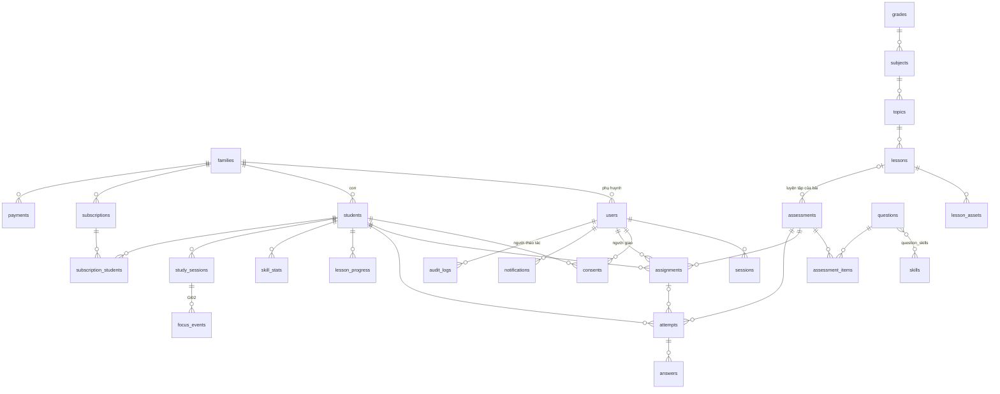

# 07. Thiết kế cơ sở dữ liệu (đề xuất)

- Phiên bản: 0.1 (PHASE 02), ngày 22/10/2026
- PostgreSQL 16, Prisma. Khóa chính `uuid` (v7). Mọi bảng có `created_at`, `updated_at` (timestamptz, UTC). Hiển thị theo giờ Việt Nam.
- Phần nội dung (M02) có thể thay đổi sau khi xem nội dung có sẵn (Q-02).

## 1. ERD

## 2. Bảng

### Tài khoản và gia đình (M01)

| Bảng | Cột chính | Ràng buộc, index |
| --- | --- | --- |
| `families` | id, name, trial_started_at, trial_ends_at, status (`trial`, `active`, `expired`) | |
| `users` | id, family_id (null với quản trị), role (`parent`, `admin`), full_name, email, phone, password_hash, google_sub, email_verified_at, phone_verified_at, mfa_secret_enc, status, deleted_at | unique(email), unique(phone), unique(google_sub) |
| `students` | id, family_id, display_name, avatar_key, grade_id, school_name, pin_hash, pin_failed_count, pin_locked_until, deleted_at | index(family_id) |
| `sessions` | id, user_id, student_id (null nếu đang ở chế độ phụ huynh), token_hash, mode (`parent`, `student`, `admin`), expires_at, ip, user_agent, revoked_at | unique(token_hash), index(user_id) |
| `verification_codes` | id, target (email/phone), purpose, code_hash, expires_at, attempts | index(target, purpose) |
| `consents` | id, user_id, student_id (null), type (`terms`, `privacy`, `camera`, `snapshots`), document_version, granted_at, revoked_at | index(student_id, type) |

### Nội dung (M02)

| Bảng | Cột chính | Ràng buộc, index |
| --- | --- | --- |
| `grades` | id, name ("Lớp 3"), order | |
| `subjects` | id, grade_id, code (`math`, `vietnamese`), name, order | unique(grade_id, code) |
| `topics` | id, subject_id, name, order, status | index(subject_id, order) |
| `lessons` | id, topic_id, code, title, summary, body (jsonb: các bước), est_minutes, status (`draft`, `published`), version | index(topic_id, order) |
| `lesson_assets` | id, lesson_id, kind (`video`, `pdf`, `image`), storage_key, size_bytes, duration_sec, title | |
| `skills` | id, subject_id, code, name | unique(subject_id, code) |
| `questions` | id, subject_id, type (`single`, `multiple`, `short`, `true_false`, `essay`), prompt (jsonb), options (jsonb), answer_key (jsonb), explanation (jsonb), difficulty, version, status | index(subject_id, status) |
| `question_skills` | question_id, skill_id | pk(question_id, skill_id) |
| `assessments` | id, subject_id, lesson_id (null), kind (`practice`, `homework_set`), title, est_minutes, status | |
| `assessment_items` | assessment_id, question_id, question_version, order, points | pk(assessment_id, order) |
| `content_imports` | id, file_key, status, total_rows, error_rows, report (jsonb), created_by | |

`answer_key` không bao giờ trả về trình duyệt học sinh trước khi nộp bài.

### Học tập (M03 đến M06, M09)

| Bảng | Cột chính | Ràng buộc, index |
| --- | --- | --- |
| `assignments` | id, family_id, student_id, assessment_id, assigned_by (user_id), due_date, status (`assigned`, `cancelled`), note | index(student_id, due_date) |
| `attempts` | id, student_id, assessment_id, assignment_id (null), started_at, submitted_at, status (`in_progress`, `submitted`, `pending_review`, `graded`), score (numeric 4,1), correct_count, wrong_count, blank_count, is_late, duration_sec | index(student_id, submitted_at), index(assignment_id) |
| `answers` | id, attempt_id, question_id, question_version, response (jsonb), is_correct (null với tự luận), points_awarded, reviewer_comment, reviewed_by, answered_at | unique(attempt_id, question_id) |
| `lesson_progress` | student_id, lesson_id, first_viewed_at, last_viewed_at, view_count, time_spent_sec, completed_at | pk(student_id, lesson_id) |
| `skill_stats` | student_id, skill_id, answered, correct, updated_at | pk(student_id, skill_id); bảng tổng hợp, tính lại được từ `answers` |
| `study_sessions` | id, student_id, started_at, ended_at, active_sec, camera_enabled | index(student_id, started_at) |
| `schedules` | id, student_id, subject_id, weekday, start_time, end_time | |

### Camera (M10, GĐ2)

| Bảng | Cột chính | Ghi chú |
| --- | --- | --- |
| `focus_events` | id, study_session_id, attempt_id (null), occurred_at, type (`focus_sample`, `looked_away`, `left_seat`, `returned`, `posture_bad`), score (0 đến 100), duration_sec | Không có cột ảnh hay video. Xóa sau 12 tháng (cần chốt) |
| `snapshots` | id, study_session_id, storage_key (mã hóa), taken_at, expires_at | Chỉ tạo nếu Q-12 đồng ý; tự xóa sau 7 ngày |

### Gói và thanh toán (M08)

| Bảng | Cột chính | Ràng buộc, index |
| --- | --- | --- |
| `plans` | id, code, base_price_vnd (50000), sibling_discount_pct (20), period_months (1), active | Giá là dữ liệu, không hardcode |
| `subscriptions` | id, family_id, plan_id, status (`active`, `past_due`, `expired`, `cancelled`), current_period_start, current_period_end | index(family_id) |
| `subscription_students` | subscription_id, student_id, position (1, 2, ...), price_vnd | pk(subscription_id, student_id) |
| `payments` | id, family_id, subscription_id, amount_vnd, provider, provider_txn_id, status (`pending`, `succeeded`, `failed`, `refunded`), raw_callback (jsonb, đã lọc thông tin nhạy cảm), paid_at | unique(provider, provider_txn_id) |

Tiền lưu bằng số nguyên VNĐ (`integer`), không dùng số thực.

### Thông báo, quản trị

| Bảng | Cột chính |
| --- | --- |
| `notifications` | id, user_id, student_id (null), type, title, body, data (jsonb), read_at, channels_sent (jsonb) |
| `notification_prefs` | user_id, type, in_app, email, zalo |
| `audit_logs` | id, actor_user_id, action, target_type, target_id, ip, metadata (jsonb), created_at; chỉ ghi thêm, không sửa xóa |

## 3. Quy tắc dữ liệu

- Mọi truy vấn dữ liệu học sinh lọc theo `family_id` lấy từ phiên đăng nhập, không lấy từ tham số người dùng gửi lên.
- Câu hỏi có `version`; `answers` và `assessment_items` lưu phiên bản đã dùng để kết quả cũ không đổi khi sửa nội dung.
- Xóa học sinh: xóa mềm ngay (`deleted_at`), worker xóa cứng dữ liệu học tập sau 30 ngày (NFR-PRIV-05). Giữ `payments` theo yêu cầu kế toán, không gắn tên trẻ.
- Migration chỉ thêm cột/bảng theo cách tương thích ngược; thay đổi phá hủy phải được chủ dự án duyệt (nguyên tắc số 7).
